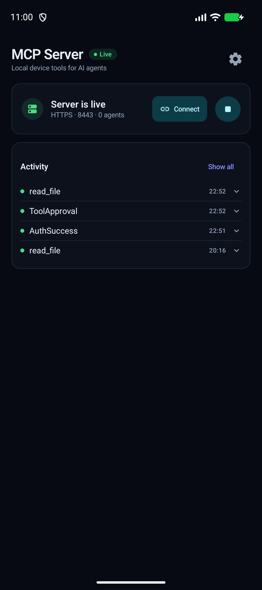
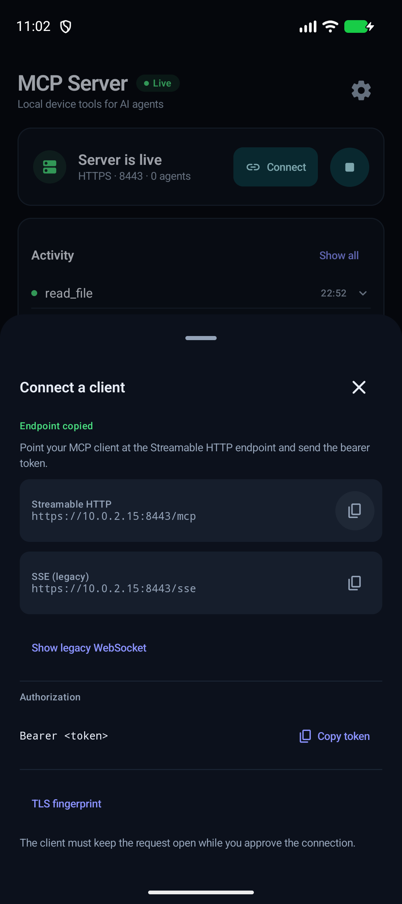
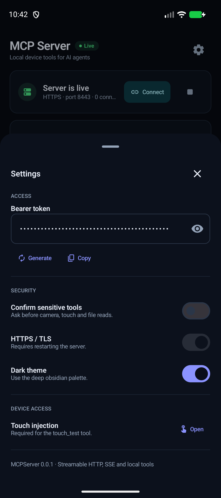
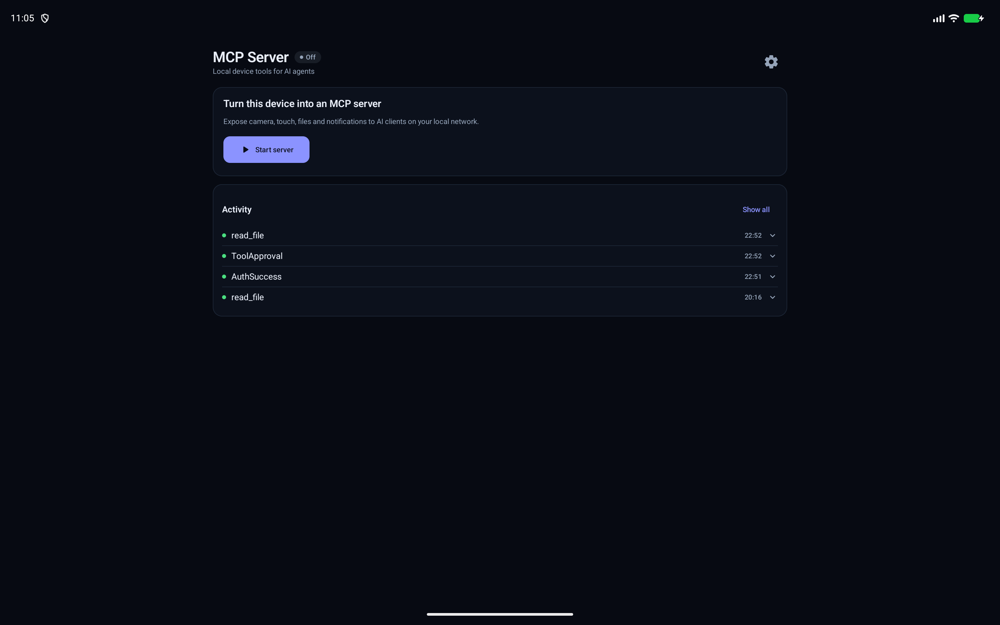
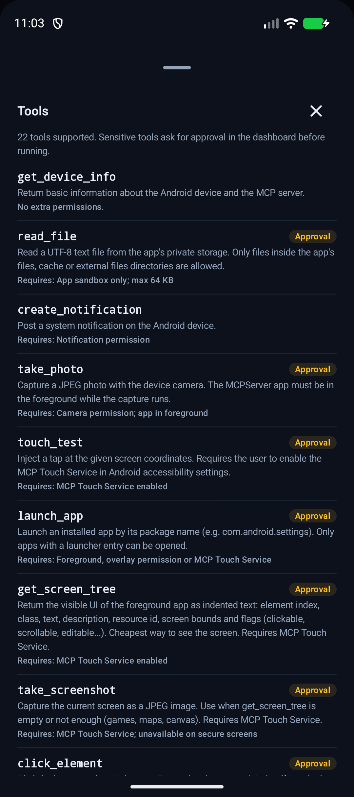
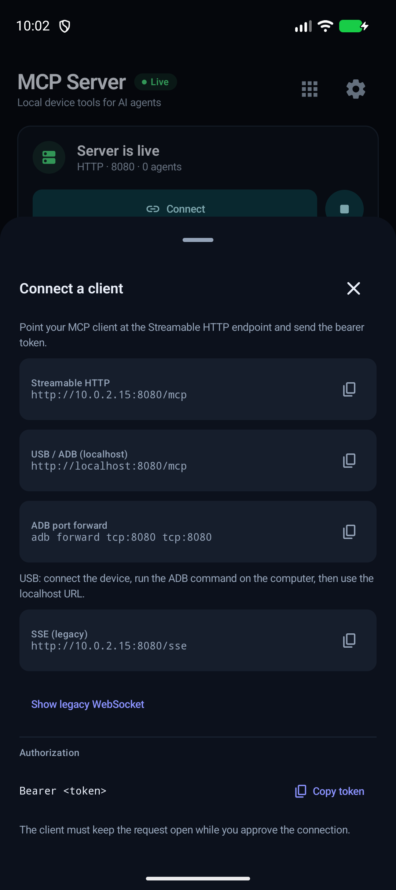
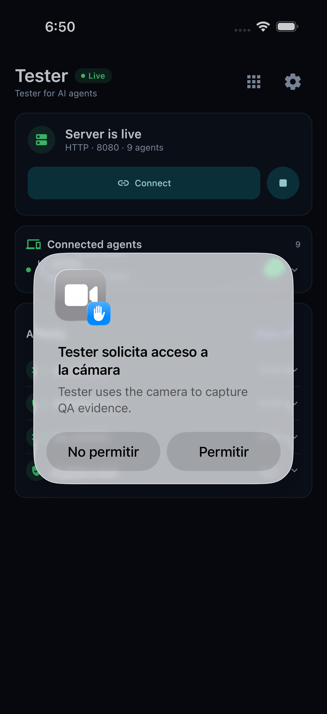

# Tester

A local [Model Context Protocol](https://modelcontextprotocol.io) server that runs on an
Android device. It exposes device tools to AI agents over the local network and shows
what is connected and what is being executed on a Compose dashboard.

Current version: **0.2.1** (Android P3 environment controls/recovery; iOS embedded QA service implemented for the simulator, physical/XCUITest pending).

## Features

- **MCP over Streamable HTTP** at `POST/GET/DELETE /mcp` (current MCP transport, with
  `Mcp-Session-Id` sessions).
- **MCP over HTTP+SSE** (legacy transport) at `GET /sse` + `POST /message`.
- **WebSocket** at `/mcp` (and the `/ws` alias) for legacy/custom clients.
- **USB / ADB connection**: run `adb forward tcp:8080 tcp:8080` and use
  `http://localhost:8080/mcp` from the computer; no Wi-Fi needed.
- **iOS QA service**: embedded MCP service on `127.0.0.1:8080` with 13 iOS tools
  (state, QA session, English TTS). See [`docs/IOS_QA_SERVICE.md`](docs/IOS_QA_SERVICE.md).
- **iOS UI bridge (0.1.3)**: Appium/XCUITest host bridge with 14 UI tools for the
  simulator; see [`docs/IOS_UI_BRIDGE.md`](docs/IOS_UI_BRIDGE.md) and
  [`docs/APPIUM_SETUP.md`](docs/APPIUM_SETUP.md). Start/stop Appium with
  `tools/appium_ios_ctl.sh`.
- **QA Gateway (0.1.5)**: one stdio MCP gateway for Android native, iOS native and
  the iOS UI bridge, with `qa_capabilities` and one cross-platform `qa_session`
  report. See [`docs/QA_GATEWAY.md`](docs/QA_GATEWAY.md).
- **JSON-RPC 2.0** dispatcher: `initialize`, `notifications/initialized`, `ping`,
  `tools/list`, `tools/call`, batching and standard error codes.
- **Hybrid authentication**: `Authorization: Bearer <token>` or manual approval from
  the dashboard (pending requests wait up to 60 seconds).
- **Per-tool confirmation**: sensitive tools (`read_file`, `take_photo`,
  `touch_test`, `launch_app`, screen navigation tools) pause and ask for **Approve tool / Reject** in the dashboard before
  executing. The confirmation can be disabled in Settings.
- **TLS/HTTPS** with a self-signed certificate generated on first use. The SHA-256
  fingerprint is shown in the dashboard.
- **SQLite** persistence for settings and command history (WAL, real timestamps,
  bounded history).
- **Browsable activity history**: the dashboard previews four entries; **Show all**
  opens a scrollable list of up to 500 recent activities. Storage failures appear
  on the dashboard; affected entries remain visible in memory but are not saved.
  History callback failures are reported in diagnostic logs without breaking tool responses.
- **Dashboard**: server status, pending requests with remote address, connected agents,
  tool execution log and connection URLs.
- **Foreground service**: while the server runs, a `dataSync` foreground service keeps
  the process alive with a persistent notification.
- **Device + QA tools**: 40 tools for device info, sandboxed files, notifications, camera,
  app launching and full accessibility-driven UI automation (screen tree, screenshots,
  clicks, text input, scrolling and global actions). See
  [`docs/TOOLS.md`](docs/TOOLS.md).
- **YAML task routes (Android)**: `run_route` executes validated, parameterized
  steps locally with one approval, bounded delays and per-step results. See
  [`docs/YAML_ROUTES.md`](docs/YAML_ROUTES.md).
- **Agent reliability (0.1.6)**: native text comparisons, structured predicate
  outcomes, capability discovery, explicit restoration failures and Android 15+
  notification compatibility. See [`docs/P0_0.1.6.md`](docs/P0_0.1.6.md).
- **Observation and targeting (0.1.7)**: `observe_screen`, container-scoped selectors,
  short-lived session-bound element references, explicit visibility geometry and
  an isolated synthetic QA fixture. See [`docs/P1_0.1.7.md`](docs/P1_0.1.7.md).
- **Durable automation (0.2.0)**: combined waits, asynchronous route execution,
  recovery-key-protected run lookup/cancellation, redacted failure bundles and
  owned JSON/Markdown artifacts. Disconnections do not replay actions; process
  restarts mark unfinished runs interrupted. See [`docs/P2_0.2.0.md`](docs/P2_0.2.0.md).
- **Explicit environment controls (0.2.1)**: owned durable touched-field restoration,
  package-targeted `open_link`, foreground write-first `clipboard`, permission/locale
  inspection and app-reported build provenance. `device_state` now requires a
  caller-retained recovery key; global dark-mode writes fail explicitly.
  See [`docs/P3_0.2.1.md`](docs/P3_0.2.1.md).

The [agent-first implementation plan](docs/AGENT_QUALITY_IMPLEMENTATION_PLAN.md)
prioritizes tool correctness, reliable observations, evidence, environment setup
and reusable scenarios. The [earlier QA roadmap](docs/QA_RELIABILITY_PLAN.md)
retains design details and device-validation findings. Both distinguish existing
tools from proposed capabilities.

## UI

Material 3 with a custom obsidian/indigo palette, compact cards and bottom sheets for
secondary information. The main column is capped at 900 dp and centered on tablets,
so the dashboard stays readable instead of stretching across a large screen.

| Dashboard | Connection sheet |
| --- | --- |
|  |  |
| **Settings sheet** | **Tablet layout** |
|  |  |
| **Tools catalog** | **USB / ADB connection** |
|  |  |
| **iOS QA service** | **iOS tools (13)** |
|  | iOS exposes the state/session/audio subset |

Settings, endpoints and the TLS fingerprint live in sheets so the dashboard only shows
what is actionable: server state, pending approvals, connected agents and recent
activity.

While the server runs, its notification is an Android 16 **Live Update** (promoted
ongoing notification): the status bar shows a capsule chip with the last activity
received (tool name or auth event) with the same icon used in the dashboard, and the expanded notification shows its time and
the endpoint. Users can turn it off in the app's notification settings.

## Requirements

- macOS/Linux with JDK 21+ (the project was built with JDK 25).
- Android SDK with API 37 (the configured compile/target SDK) and build-tools.
- An Android 15+ device or emulator (minSdk 35) on the same network as the AI client,
  or connected through ADB forwarding. Live Update notification chips require Android 16+.

## Build and install

```bash
./gradlew :androidApp:assembleDebug
adb install -r androidApp/build/outputs/apk/debug/androidApp-debug.apk
```

If an older build of the app is installed with a different signing key, Android
rejects the update with `INSTALL_FAILED_UPDATE_INCOMPATIBLE`. Uninstall the old app
first (this deletes its local database and settings) or install from the same
development environment.

## Run

1. Open **Tester** and tap **Start**. The server listens on:
   - `http://<device-ip>:8080/mcp` (Streamable HTTP)
   - `http://<device-ip>:8080/sse` (legacy SSE)
   - `ws://<device-ip>:8080/mcp` (legacy WebSocket; `/ws` is an alias)
2. Open **Settings** and copy the bearer token. It is generated on first launch and
   stored in the app's database.
3. Configure your MCP client with the `/mcp` URL and the `Authorization: Bearer <token>`
   header. The app requests notification and camera permissions on first launch. For
   the accessibility tools, open **Settings → Device access → Open** and enable
   **MCP Touch Service** in Android accessibility settings.

### USB / ADB

No Wi-Fi required. With the device connected by USB:

```bash
adb forward tcp:8080 tcp:8080
```

Then point the client at `http://localhost:8080/mcp`. The app's **Connect** sheet shows
the URL and the exact ADB command. With TLS enabled the port is 8443
(`adb forward tcp:8443 tcp:8443` and `https://localhost:8443/mcp`).

Example client configuration (the exact schema depends on the client):

```json
{
  "mcpServers": {
    "android-device": {
      "type": "http",
      "url": "http://192.168.1.50:8080/mcp",
      "headers": {
        "Authorization": "Bearer <your-token>"
      }
    }
  }
}
```

If the token is missing or incorrect, the request appears in **Pending Connection
Requests**. Tap **Approve** to let it continue or **Reject** to return `401` and close
it. The MCP client must keep the request open while you decide (the server times out
after 60 seconds).

### curl examples

```bash
TOKEN="<your-token>"
BASE="http://192.168.1.50:8080"

# Initialize and capture the session id
curl -i -X POST "$BASE/mcp" \
  -H "Authorization: Bearer $TOKEN" \
  -H 'Content-Type: application/json' \
  -d '{"jsonrpc":"2.0","id":1,"method":"initialize","params":{"protocolVersion":"2025-06-18","capabilities":{},"clientInfo":{"name":"curl","version":"1"}}}'

# List tools (use the Mcp-Session-Id returned above)
curl -X POST "$BASE/mcp" \
  -H "Authorization: Bearer $TOKEN" \
  -H "Mcp-Session-Id: <session-id>" \
  -H 'Content-Type: application/json' \
  -d '{"jsonrpc":"2.0","id":2,"method":"tools/list"}'

# Call a tool
curl -X POST "$BASE/mcp" \
  -H "Authorization: Bearer $TOKEN" \
  -H "Mcp-Session-Id: <session-id>" \
  -H 'Content-Type: application/json' \
  -d '{"jsonrpc":"2.0","id":3,"method":"tools/call","params":{"name":"get_device_info","arguments":{}}}'
```

## Endpoints

| Method | Path | Description |
| --- | --- | --- |
| `POST` | `/mcp` | Streamable HTTP JSON-RPC requests. Returns JSON or SSE. |
| `GET` | `/mcp` | Streamable HTTP server-to-client SSE stream (requires `Mcp-Session-Id`). |
| `DELETE` | `/mcp` | Ends a session. |
| `GET` | `/sse` | Legacy SSE stream; emits `event: endpoint` with `/message?sessionId=...`. |
| `GET` | `/mcp/sse` | Alias of `/sse`. |
| `POST` | `/message?sessionId=...` | Legacy SSE request endpoint; returns `202` and pushes the response to the stream. |
| `WS` | `/mcp` | Legacy WebSocket transport (also available at `/ws`). |
| `GET` | `/` | Human-readable server info. |
| `GET` | `/health` | `{"status":"ok"}`. |
| `GET` | `/status` | JSON status, port, session counts and TLS fingerprint. |

All MCP endpoints reject browser requests whose `Origin` is not a local development
origin (DNS-rebinding/CSRF protection) and limit request bodies to 256 KB.

## Tools

The complete catalog with arguments, requirements and approval behavior is in
[`docs/TOOLS.md`](docs/TOOLS.md); the QA workflow is in
[`docs/QA_PACK.md`](docs/QA_PACK.md). The app also shows the catalog from the grid
icon in the header (**Tools**).

| Tool | Status | Description |
| --- | --- | --- |
| `get_device_info` | Available | Android version, manufacturer, model, app version and local IP. |
| `read_file` | Available | Reads UTF-8 text files inside the app sandbox (`files`, `cache`, external files). Max 64 KB. |
| `create_notification` | Available | Posts a system notification. Requires the notification permission. |
| `take_photo` | Available (foreground) | Captures a JPEG with CameraX and returns an MCP `image` content block plus the file path. The app must be in the foreground. |
| `touch_test` | Available (accessibility) | Injects a tap at `x,y`. Requires the user to enable **MCP Touch Service** in Android accessibility settings. |
| `swipe` | Touch Service | Swipe by direction/coordinates with `duration_ms` (speed), `distance`, `count`, `interval_ms`. |
| `get_app_version` | Available | versionName/versionCode/install times of an installed app. |
| `get_logs` | Touch-free, sensitive | Filtered logcat (`package_name`, `level`, `query`, `crashes`). Includes earlier (crashed) processes of the package. Other apps' logs need `adb shell pm grant com.vlad.mcpserver android.permission.READ_LOGS` plus tapping **Allow** on Android's one-time log-access dialog. |
| `list_apps` | Available | Lists launchable apps (name + package), optional `query` filter. |
| `health_check` | Available | Cheap probe: server time, uptime, version, Touch Service state. Use it to verify the connection and retry the transport on failure. |
| `launch_app` | Available (foreground, overlay or accessibility) | Launches an installed app by `package_name` or visible `app_name` (ambiguous names return candidates). From the background it requires **Display over other apps** (Settings → Device access) or **MCP Touch Service** (Android background activity-start restrictions). Waits until the app is in the foreground and its UI settled (`wait_ms`, default 8000, 0 disables). |
| `get_screen_tree` | Available (accessibility) | Returns the foreground app's UI as indented text: index, class, text, description, resource id, bounds and flags. Preferred way for an AI to "see" the screen. |
| `take_screenshot` | Available (accessibility) | Captures the screen as a JPEG (`max_dimension`, default 1280). Fallback for games, maps or canvas UIs. Fails on `FLAG_SECURE` screens. |
| `click_element` | Available (accessibility) | Clicks or long-presses an element by `index` (from the last tree), `text`, `resource_id`, `content_desc` or `class_name`; `text_exact` avoids partial matches (an exact match wins among several partial ones). Elements without a click action (e.g. MAUI) are tapped at their center. |
| `input_text` | Available (accessibility) | Sets the text of an editable field (focused field or selector via `match_text`/`index`/`resource_id`/`content_desc`); optional `submit`. |
| `scroll` | Available (accessibility) | Scrolls `up`/`down`/`left`/`right` on the largest or selected scrollable element. |
| `global_action` | Available (accessibility) | `back`, `home`, `recents`, `notifications`, `quick_settings`, `lock_screen`. |
| `qa_session` | Available (QA pack) | Begin/step/status/end a QA case; end restores owned touched fields using `state_key` and fails the report if cleanup fails. |
| `ui_find` | Available (QA pack) | Find all matching elements with flags/bounds; returns JSON count and matches; `match_index` equals the `nth` used by `click_element`. |
| `observe_screen` | Available (Android) | Correlated accessibility observation with session-bound references and optional window screenshot; explicit timestamps, instability and capture errors. |
| `ui_wait` | Available (QA pack) | Wait for visible/absent/text/idle with timeout; `idle` with `package_name` also waits for that app to be in front (no false positive during launch). |
| `ui_assert` | Available (QA pack) | Assert visible/absent/text/count; failure returns screenshot + tree excerpt. |
| `ui_gesture` | Available (QA pack) | tap, double_tap, multi_tap, long_press, swipe, drag, pinch; selector or coordinates. |
| `audio_instruction` | Available (QA pack) | TTS/audio instructions for the tester, stop, volume; English by default. |
| `audio_state` | Available (QA pack) | Volume, music active, TTS speaking, QA player playing. |
| `get_device_state` | Available (QA pack) | Theme, rotation, font scale, volume, locale, accessibility, foreground package. |
| `device_state` | Conditional (Android) | Set/status/restore owned rotation, font scale, animations, volume, keep-awake using required `state_key`; effective readback and durable pending cleanup. Global dark mode unsupported. |
| `ui_diff` | Available (QA pack) | Save visual baseline / compare current screen with diff percentage. |
| `open_link` | Conditional (Android) | Open an approved URI in one explicit app and verify foreground readiness; no arbitrary intents/flags. |
| `clipboard` | Conditional (Android) | Foreground consented write/read-owned/clear-owned plain text; never snapshot unrelated clipboard contents. |
| `get_test_environment` | Available (Android) | Inspect target permission flags and available app-locale override; explain unsupported privileged setup. |

Recommended navigation loop for agents: `get_screen_tree` → `click_element` /
`input_text` / `scroll` → `get_screen_tree` again; use `take_screenshot` only when
the tree is empty or ambiguous.

Sensitive tools (`read_file`, `take_photo`, `touch_test`, `launch_app`, all
screen navigation tools, `ui_gesture`, `audio_instruction`, `device_state`,
`open_link` and `clipboard`) wait for an explicit
**Approve tool** action in the dashboard before running. The **Confirm sensitive
tools** switch in Settings disables this gate. Tools that cannot run in the current
state return `isError: true` with an actionable message instead of a fake success.
Touch injection is powerful: enable the accessibility service only if you trust the
clients that hold the bearer token.

## TLS

Enable **SSL/TLS** in Settings and restart the server. On first use the app generates a
self-signed certificate valid for two years with SAN entries for the device's IPv4
addresses, `localhost` and `127.0.0.1`:

- The certificate and key are stored in `files/mcp-tls.p12`.
- The SHA-256 fingerprint is shown in the dashboard and in `/status`.
- Clients must trust the certificate (or use "insecure/trust on first use" for local
  testing). If the device IP changes, the certificate is regenerated and the
  fingerprint changes.
- The bearer token is encrypted at rest with an AES-256-GCM key in the Android
  Keystore; the app database only stores the `enc:v1:` payload.

## Tests

```bash
./gradlew :shared:testAndroidHostTest   # protocol, auth, ViewModel
./gradlew :shared:compileKotlinIosSimulatorArm64
```

The suite (40 tests) covers JSON-RPC dispatch, protocol negotiation, tool schema
validation, errors/batches/notifications, bearer parsing, token storage behavior,
tool-approval events and the ViewModel event flow. Camera, accessibility, foreground
service and approval UI are verified manually on a device/emulator because they need
platform services.

## Architecture

```
androidApp/          Activity + Compose entry point
shared/
  commonMain/
    mcp/             JSON-RPC dispatcher, tools, sessions, auth, host interface
    App.kt           Compose dashboard and settings
    AppViewModel.kt  State, event reduction, persistence coordination
    Database.kt      SQLite (WAL, serialized access)
  androidMain/
    mcp/             Ktor server (CIO/Netty), Streamable HTTP/SSE/WS, TLS, tools
    McpServerKeepAliveService.kt      Foreground service + notification
    McpTouchAccessibilityService.kt   Tap injection
    CameraCapture.kt                  CameraX still capture
    SecretStorage.android.kt          Keystore AES/GCM token encryption
  iosMain/           Embedded iOS QA service (Ktor CIO, localhost) + iOS tools
```

The server owns a session registry and an approval gate. Transports only translate
bytes; they all call the same `McpDispatcher` and `ToolExecutor`, so protocol behavior
is consistent across HTTP, SSE and WebSocket. The iOS target runs the same dispatcher
with a five-tool, localhost-only QA service.

## Known limitations / next steps

- The keep-alive service uses `dataSync`; Android 15+ limits that foreground type to a
  few hours per day. A long-running host should use a dedicated foreground type and a
  battery-optimization exemption.
- `take_photo` only runs while the app is in the foreground. Capturing from the
  background would require a camera foreground service and Android's background
  camera restrictions.
- `touch_test` requires the user to enable the accessibility service manually.
- The per-tool confirmation can be disabled; when disabled, an approved session can
  call sensitive tools without another prompt.
- The app does not advertise itself over mDNS/Bonjour or show a QR code yet.
- Self-signed TLS requires client trust; for production, use a proper certificate or
  pin the fingerprint.
- The iOS QA service runs only while the app is in the foreground and exposes 13 tools.
  For cross-app simulator screenshots, configure the separate
  [Mac-side screenshot MCP bridge](docs/IOS_SIMULATOR.md).
  Physical-device XCUITest, `iproxy`, the host gateway and Keychain token storage are
  still pending.

## Repository note

`recovery/` contains a forensic copy of an older Apply Changes overlay and its
decompiled classes. It is not part of the app and can be deleted once the source is
recovered/committed.

### Reliability notes

- `global_action` accepts `count`/`interval_ms` (e.g. Back x2 repeated reliably).
- `install_apk` and `screen_record` are intentionally not provided: Android requires an on-screen user confirmation (package installer / MediaProjection).
- `take_screenshot` waits for the UI to settle (`settle_ms`, default 1500) and reports a capture timestamp and foreground package.
- Selector-based actions refuse ambiguous matches: use `within`, a session-bound
  `element_ref`, or an explicit `nth` (0-based, same as `ui_find` `match_index`).
  Actions default to fully visible reported geometry; no implicit exact-match preference.
- `take_screenshot` accepts `package_name` to wait for that app and warns when Tester itself is in front.
- Dark mode/animation changes need `adb shell pm grant com.vlad.mcpserver android.permission.WRITE_SECURE_SETTINGS`; `health_check` reports which special accesses are granted.
- `touch_test` failures explain the likely cause (no window, transition, screen off).
